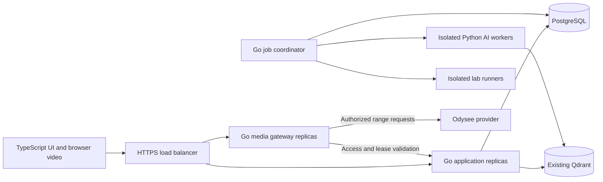

# CourseForge Go backend and TypeScript player plan

Status: implementation in progress; production gates remain unproven. Updated 2026-10-12. Repository inspected at
`bb377f0` with existing uncommitted UI and other changes; those changes are not
part of this planning task.

## Confirmed direction and unresolved inputs

- Go will own the application backend; TypeScript will own browser player logic.
- Odysee remains the video provider. Preserve existing upload mappings and IDs.
- Design and test for **10,000 concurrent learners**. This is a target, not a
  measured capacity or a promise of 10,000 simultaneous AI jobs.
- Retain Python for isolated AI/media-processing adapters where needed. Replace
  the Python web backend incrementally in staging, including all existing features.
- The user wants the existing server and Cloudflare access setup retained. The
  current Quick Tunnel reaches the legacy loopback origin on port8000. Its
  temporary hostname and request ceiling are documented in
  [DEPLOYMENT_CONTRACT.md](rewrite/DEPLOYMENT_CONTRACT.md); it is a preview path,
  not the 10,000-learner production acceptance topology.
- Hosting region, monthly budget, learner geography, average
  video bitrate, and Odysee concurrency/rate limits remain unknown. They affect
  infrastructure sizing and the final supported audience, not the language choice.

The current scope is the full implementation, including the user-requested premium
course discovery UI and player. M1/M2 have scoped behavior evidence; M3 is in
progress. Production capacity will be established by the separate
[capacity contract](GO_TYPESCRIPT_CAPACITY.md).

## UI and playback direction added 2026-10-12

The user requested a polished experience inspired by YouTube, Netflix, Prime Video
and [7Movies](https://7movies.ac/). The reference's featured banner, ranked rows and
saved-list navigation inform CourseForge's discovery layout. Build original course
presentation using actual authorized course metadata/artwork, continue-learning,
search and saved-list state. Keep course/lesson terminology and existing learning
tools. The detailed behavior and visual gates are in
[UI_PLAYER_CONTRACT.md](rewrite/UI_PLAYER_CONTRACT.md).

"No buffering" is the desired experience; its measurable acceptance remains the
startup, seek, rebuffer and fatal-rate contract. Network throughput, available
provider renditions and Odysee availability constrain it. Add real quality controls
only for actually available renditions; a bitrate label or fake quality menu is not
adaptive playback. Preserve the separate API, media and AI capacity verdicts.

## Evidence from the current application

| Evidence | Planning consequence |
| --- | --- |
| [Academy validation](ACADEMY_VALIDATION.md) records 150 authenticated sessions, 1,800 requests, 86.69 RPS, p95 4.793 seconds, zero failures | Useful historical reference, not a fresh benchmark; excludes login, media, SMTP and AI/grading |
| [Capacity script](../scripts/academy_capacity.py) uses a short closed workload and caps sessions at 500 | Build new sustained and arrival-rate tests; do not extrapolate that script to 10k |
| [SQLite access](../app/db.py) uses application functions for learner context | Port authorization explicitly; PostgreSQL does not inherit this implicit filtering |
| [Native media](../app/native_player.py) proxies provider bytes; [main](../app/main.py) admits 24 media transfers per process | Separate application and media capacity; 24 transfers is not a learner limit |
| [Player](../app/static/native-player.js), [ownership](../app/static/player-session.js), [activity](../app/static/academy.js) send periodic requests | Consolidate transport while preserving distinct learning/playback semantics |
| [Index worker](../app/worker.py) and [academy worker](../app/academy_worker.py) assume single-worker execution | New job leases, retry safety and per-resource concurrency limits precede horizontal worker scaling |

These observations do not establish Python as the cause of slow responses.
Collect traces, query timings, browser metrics and resource usage before attributing
latency to a language or promising a speedup.

## Proposed architecture

Start with a modular Go application, one repository and shared contracts. The
media gateway and job coordinator use separate entrypoints because their network,
CPU/GPU and failure characteristics differ. Do not split every product feature
into a separately deployed service.

| Area | Proposed choice and rationale |
| --- | --- |
| HTTP | Go `net/http`, explicit middleware, context deadlines, structured errors, versioned OpenAPI |
| Persistence | PostgreSQL, `pgxpool`, SQL migrations, `sqlc` generated queries; explicit transactions and learner predicates |
| Browser | Strict TypeScript, Vite build, existing HTML/CSS and Media Chrome initially; native `<video>` handles decoding |
| Media | Dedicated Go range proxy retaining Odysee authorization, preparation and redirect restrictions |
| Background work | PostgreSQL durable jobs, transactional outbox, leases and fencing; resource-specific worker pools |
| AI retrieval | Existing Qdrant and configured model providers behind typed adapters; separate worker concurrency |
| Observability | Request IDs, structured logs, metrics and traces; private Go profiling endpoints |
| Verification | Go race/integration tests, TypeScript behavior tests, Playwright browser tests, k6 workloads |
| Caching | Versioned public catalog caching first; add shared cache infrastructure only with a concrete need and invalidation contract |

Pin supported toolchain/package versions in M1 after checking compatibility; this
plan is not a claim about which versions are newest. No Kubernetes, Kafka or Redis
dependency is required merely because the user target is 10k. The hosting decision
can select an orchestrator later without changing product interfaces.

## Module interfaces and ownership

| Go module | Owns | Required interface behavior |
| --- | --- | --- |
| identity | Accounts, password hashes, sessions, CSRF, invitations, recovery, roles | Revoke access across replicas; bounded password verification; preserve last-admin protection |
| catalog | Courses, lessons, modules, publication, materials, source IDs | Cursor pagination, stable IDs/order, bounded search and file access |
| access | Enrollment and content authorization | Explicit caller identity and course scope on every protected operation |
| learning | Notes, bookmarks, progress, reviews, plans, habits, focus, assessments | Learner isolation, duplicate-safe writes, explicit time/accounting semantics |
| playback | Player leases, resume, event acknowledgement, coverage, preferences | Atomic takeover; ordered/deduplicated events; distinguish position, watched coverage and page activity |
| media | Odysee adapter, source preparation, byte forwarding | Bounded transfers; cancellation; account/session/lesson binding; periodic revalidation |
| jobs | Task state, retries, cancellation, worker leases, results | At-least-once delivery with idempotent effects; stale workers cannot commit results |
| administration | Reports, exports, account/course controls, audit | Paginated queries, queued large exports, authorization and CSV protections |

Use small interfaces that hide transactions, retry policy and provider details.
Introduce adapters at actual variations such as Odysee versus the deterministic
media simulator. Avoid a generic repository abstraction for every table.

## Player port and media requirements

Build typed modules for player control, HTML video access, session ownership,
progress delivery, recovery, preferences and lesson navigation. Inject transport,
clock and UI callbacks rather than depending on global `window` state. Every lesson
load has an abort scope and generation ID; stale requests cannot affect a new lesson.

Preserve speed, volume, seeking, resume/restart, fullscreen/theater, touch and keyboard
controls, captions when present, watermark, drawer focus, timestamp capture, native
controls fallback, materials integration and responsive layouts. Keep native and
embedded capabilities explicit: cross-origin embedded playback cannot provide the
same tracking or seeking guarantees.

Unify the three periodic transports into a versioned session pulse approximately
every 10 seconds with jitter. Keep page visibility, playback position, elapsed time
and ownership as separate fields. Preserve immediate pause/seek/end/takeover events,
server-bounded credit, duplicate suppression and a bounded client retry queue.
Acknowledge durable updates only after commit. Track explicit completion separately
from coverage-based automatic completion; retain current rules unless deliberately
changed in the behavior contract.

When hidden, offline or displaced by takeover, pause and release ownership. Reclaim
only after deliberate user action; reconnecting must not steal another tab's lease.
Cancel retries on disposal and terminal authorization failures. Queue exhaustion
must fail visibly and safely rather than inventing acknowledgement or watch credit.

Behavior correction to include in acceptance: autoplay disabled never navigates
automatically; autoplay enabled waits until the media ends before its cancellable
countdown. The current near-end path in `player-studio.js` can navigate early and
does not consistently honor the preference; reproducing that bug is not required.

Odysee source URLs and account credentials remain server-side. Preserve HEAD,
Range, 206/416, approved redirects, content-type checks, stream disconnect cleanup,
and source preparation before range delivery. Restrict per-host/global outbound
concurrency, deduplicate source resolution, honor provider backoff and bound retries.
Do not cache private bytes publicly or assume Odysee supplies HLS renditions.

A provider-approved direct delivery design can be evaluated, but it must meet the
access/revocation contract. The default remains the authenticated gateway. Replacing
it with a public provider URL would change access behavior. Existing buffered bytes
cannot be recalled even when an active stream is revoked.

## Feature parity inventory

M0 turns this inventory into endpoint and browser contracts with an owner and gate
for every row. Source-string tests are not substitutes for browser behavior tests.

| Slice | Existing areas to account for | Acceptance evidence |
| --- | --- | --- |
| Identity/access | `auth.py`, `academy.py`, registration/invitations/recovery, enrollments | Existing positive/negative access cases pass against Go; cross-user reads/writes denied |
| Catalog/discovery | library, streaming home/browse/title/search, metadata, materials | Same immutable IDs/mappings and publication rules; ordered pagination and safe downloads |
| Player | native player, sessions, delivery, recovery, studio | Real deterministic media, takeover, revoke, seek, resume, no double credit, autoplay preferences |
| Learning records | study, reviews, assessments, practice, learning paths | Migration counts plus semantic comparisons; feedback/results remain private |
| Planning/habits | planner, weekly, focus, habits, engagement, retention | Timezone/day boundaries, pause lifecycle and distinct time metrics |
| AI/import | tutor, vectorstore, extractor, vision, syllabus, companion | Source citations and timestamps, durable progress, bounded retries and tenant context |
| Labs | labs, lab tracks/graders, academy tasks | Curated execution only; sandbox/resource limits, cancellation, duplicate-safe result publication |
| Administration | admin console, audit, player reports, exports, deletion | Account revocation, retained aggregates, deletion/retention and export parity |
| Delivery/operations | static assets, service worker, deployment/release scripts | Cache refresh, API/media exclusions, mobile browser checks, backup/restore and release gates |

## Migration strategy

Develop and validate vertical slices in a separate staging stack with synthetic
fixtures and controlled snapshots. Existing production Python/SQLite remains the
sole authority until cutover. A new frontend may exercise legacy endpoints through
a compatibility adapter during development, but do not create two independent
production writers for the same learner records.

The SQLite-to-PostgreSQL importer preserves stable IDs, ownership, timestamps,
ordering, notes, coverage intervals, assessment results, aggregates, provider mappings
and artifact references. Validate counts, foreign keys, checksums for stable content,
and semantic equivalence for transformed values. FTS indexes are rebuilt. Copy
password hashes with verified Argon2 compatibility, never plaintext. Plan to invalidate
active login/player sessions at cutover and require sign-in; record this visible change.

For the first production migration, use a rehearsed write freeze, pause/drain old
workers, take a consistent backup, import and verify the final snapshot, then switch
traffic. The allowed maintenance window must be set from measured import duration.
AI workers use a versioned internal job protocol owned by Go; they no longer mutate
the old application database. Stage generated artifacts and fence stale job attempts.

The migration manifest includes artifact paths/checksums, vector collection/index
generations and job checkpoints mapped to stable database IDs. Snapshot these stores
after workers stop, or document and test rebuilding vectors from preserved source
artifacts. Use versioned collections during rehearsal so new indexing cannot mutate
the live index. Verify restored retrieval citations and artifact access as well as SQL
counts; a database-only backup is not a complete application recovery.

Before the first new write, rollback can restore routing to the frozen old stack.
After PostgreSQL accepts writes, simply switching back loses data: use a validated
reverse/replay process, or enter maintenance and fix forward. A rehearsed post-write
recovery path and backups are required before cutover. Any cohort rollout must have
one authoritative store per record and a tested routing rule; it is not the default.

## Milestones and exit criteria

| Milestone | Work | Exit criterion |
| --- | --- | --- |
| M0: contracts and baseline | Inventory routes/features; capture sanitized behavior fixtures; profile existing API/player; specify Odysee simulator and capacity workload | Every parity row has tests/owner; reproducible baseline report distinguishes API, media and AI |
| M1: executable Go slice | `backend/` Go module, PostgreSQL schema/migrations, OpenAPI, auth/access/catalog/progress, health and isolated Compose stack | Sign in → permitted lesson → save/read progress passes; cross-user denial and Go race checks pass |
| M2: typed player and Odysee gateway | `web/` TypeScript player, compatibility adapter, unified pulse, gateway, provider simulator | Playback/recovery/mobile/access contracts pass; one-replica capacity curve recorded |
| M3: remaining product and jobs | Port all learning/admin endpoints; durable leases/outbox; AI/lab adapters; migration importer | All inventory rows covered; crash/retry/ownership tests and migration rehearsal pass |
| M4: scale and resilience | Tune queries/indexes/pools; scale replicas; isolate media; distributed load, node loss, dependency faults | Capacity contract passes at 10k on named hardware; provider-limited results are explicitly separate |
| M5: release and migration | Final backups, recovery rehearsal, production configuration and cutover runbook | Full parity, device checks and scoped capacity evidence complete; post-write recovery demonstrated |

M0/M1 come first. Once interfaces stabilize, backend and player implementation can
proceed concurrently with a separate verification agent. M4 requires M2 and M3;
production cutover requires all preceding gates. Set calendar estimates after M0
establishes endpoint count, migration complexity and available implementation capacity.

## Decisions still needed before production sizing

1. Hosting hardware/region and monthly budget, including media transfer.
2. Actual learner geographies and representative media bitrates/formats.
3. Odysee's supported request/concurrency envelope for this account and delivery mode.
4. Acceptable maintenance window, restore objective and backup retention.
5. AI model/GPU capacity and fair-use limits, independently of active learners.

Continue building contracts and the isolated first slice while these are unresolved.
Report any capacity ceiling with the measured workload and infrastructure cost;
"maximum users" is an experimental result, not a property of Go.

Agent roles and installed tooling are recorded in
[the implementation workflow](GO_TYPESCRIPT_AGENTS.md).
